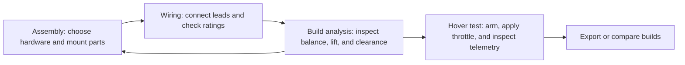

# BLAZE Workshop

BLAZE Workshop is a browser-based multirotor simulator. Assemble a quadcopter or hexacopter, place parts on a built-in or imported frame, connect the wiring, and see how propulsion and weight distribution affect hover.

The app is a static site. STL meshes, datasheets, build files, and calculations are processed in the browser. The typical build is saved in the current browser. Export a build to share it or preserve an STL and its placements across sessions.

## Run locally

Clone this repository and serve `dist/` over HTTP. Python 3 is sufficient. The app has no build step.

```sh
git clone https://github.com/Abdelrahman-Ashraf1886/Blaze-Simulator.git
cd Blaze-Simulator
python3 -m http.server 8000 --bind 127.0.0.1 --directory dist
```

Open [http://localhost:8000](http://localhost:8000). On Windows, use `py -3` in place of `python3`. For a standalone copy with launch instructions, download and extract [BLAZE-Workshop-Local.zip](dist/BLAZE-Workshop-Local.zip).

Serve `.mjs` and `.js` files as JavaScript. Use the compatibility view if the browser lacks WebGL.

## Start with the example



1. Click **Load example** and inspect the prewired assembly.
2. Open **Hover test**, click **Arm simulation**, then click **Hold 1 m**.
3. Return to **Assembly**, add a weight, and mount it near the center or on an arm. Compare motor output, pitch, roll, lateral drift, and balanced lift reserve.
4. Use **Save and share builds** to export the result. Capture the original and modified setups in **Compare builds** to see the difference side by side.

## Assembly and placement

- **Frame layout** switches between Quad X and Hex X. Pick a battery, motor and propeller combination for each rotor, an ESC, a flight controller, and any supported peripherals.
- **Import STL** accepts binary or ASCII STL files up to 25 MB. Set the source units, up axis, and measured frame mass. STL contains exported mesh geometry. For imported frames, place every component required for the test.
- Select a part in 3D or in the **Component** list, choose **Move on frame**, and click the mounting surface. Use **Top**, **Bottom**, **Left**, **Right**, or **Orbit** to reach other faces. **Rotate 90°** and **Ctrl+R** turn the selected part around its mounting surface.
- In **Placeable weights**, enter grams, click **Add weight**, and click the frame to mount it. Each weight can be moved or removed independently. Unplaced weights count toward build mass and must be placed before arming.
- **Diagnostics and clearance** flags potential part overlaps and propeller contact with the frame, parts, or another propeller. Component shapes are screened with bounding boxes and props are checked as swept disks.

## Wiring and power

- In **Wiring**, drag a lead from one pin to another or select two pins. **Auto-wire** applies the reference harness. Click a connection label to remove that lead.
- **Customize wire colors** changes the diagram, pin indicators, and 3D wiring together. The UART TX and RX color labels are from the flight controller’s side. A controller TX lead goes to the receiving device’s RX.
- **Add series pack** adds a battery to the series harness. Two 3S 1500 mAh packs model 6S at 22.2 V nominal and 1500 mAh. The series model adds pack voltage and resistance and uses the lowest pack capacity and current rating.
- **Components → Pixhawk peripherals** includes receivers, telemetry, GNSS, I²C sensors, and DroneCAN devices. A shared serial port conflict is flagged during preflight.
- For a Pixhawk 6C or 2.4.8, open **Wiring → Inspect Pixhawk sockets in 3D**. Select a socket and inspect its numbered contacts. Connectable contacts participate in the simulator, and reference contacts show the board pinout. The 2.4.8 uses the Pixhawk 1 reference layout. Check the actual board revision and connector orientation before wiring hardware. [PX4 Pixhawk 1 reference](https://docs.px4.io/v1.16/en/flight_controller/pixhawk) · [Holybro Pixhawk 6C pinouts](https://docs.holybro.com/autopilot/pixhawk-6c/pixhawk-6c-ports)

## Custom parts and measured data

### Add a component from a datasheet

Open **Components → Add component**, choose the part type, and upload a PDF, TXT, CSV, or Markdown datasheet. Review extracted fields, complete any blanks, and use **Add to build**. A part is installed if a slot is empty. Otherwise it is available from the corresponding model selector.

The catalog supports custom brushless motors, propellers, LiPo batteries, ESCs, and generic 5 V flight controllers. Scanned PDFs require manual entry. For a motor, use static thrust and current from the same test point and enter its test voltage.

### Add a measured thrust curve

Open **Measured motor and propeller data**, choose the exact motor and propeller, enter the bench-test voltage, and import a CSV. Use these headers and supply throttle points in increasing order. The numbers below show the format.

```csv
throttle_pct,thrust_g,current_a
0,0,0
25,90,2.1
50,310,6.8
75,650,13.2
100,1020,22.5
```

The curve applies to every matching motor and propeller pair in the build. The simulator interpolates measured data and adjusts effective throttle for loaded battery voltage.

## Analysis and flight

| Readout | Interpretation |
| --- | --- |
| Thrust-to-weight | Estimated static thrust divided by all-up weight. It updates as motors are selected. An incomplete or incompatible configuration can show a reference estimate while arming stays blocked. |
| Balanced lift limit and reserve | How much lift the modeled rotors can generate while balancing pitch and roll around the center of mass, and how much exceeds the build weight. |
| Hover telemetry | Altitude, vertical speed, pitch, roll, lateral drift, individual motor output, voltage, current, thrust, and remaining battery. |
| Electrical diagnostics | Battery sag, current limits, motor and ESC compatibility, and the reason an electrical limit is reached. |

**Stabilize pitch and roll** is on by default. Turn it off to see how a shifted load responds to equal throttle. A heavily off-center build can tip even when it has enough total thrust to lift. If the motors lack enough authority to balance the load, **Hold 1 m** is unavailable. The final telemetry stays visible after a tip or battery cutoff.

The simulator uses estimated motor curves unless bench data is supplied. Imported frame mass is placed at its bounding-box center for balance estimates. Flight models vertical motion, pitch, roll, and lateral drift. Flight firmware, sensor data streams, wind, and detailed aerodynamics are outside the model.

## Share and compare builds

- **Export build** creates a versioned `.blaze.json` file with the parts, custom catalog, wiring, wire colors, measured curves, weights, and mounting positions. Enable **Include imported STL** to create a self-contained file.
- **Import build** restores the project. If the export omitted the STL, use **Import STL** to attach the original mesh and restore its mount coordinates.
- **Capture current as A** and **Capture current as B** save metric snapshots in the current browser. Use the **B − A** column to compare changes. Share the original build files for reproducibility.

## Code map

| Files | Responsibility |
| --- | --- |
| [`index.html`](dist/index.html), [`style.css`](dist/style.css), [`app.mjs`](dist/app.mjs) | Interface, local state, build workflows, wiring interactions, and simulation controls |
| [`model.mjs`](dist/model.mjs), [`peripherals.mjs`](dist/peripherals.mjs) | Parts catalog, wiring graph, series packs, electrical limits, thrust estimates, and peripheral signals |
| [`flight.mjs`](dist/flight.mjs), [`layout.mjs`](dist/layout.mjs), [`weights.mjs`](dist/weights.mjs) | Thrust allocation, motor response, mass distribution, and placeable weights |
| [`scene.mjs`](dist/scene.mjs), [`canvas-view.mjs`](dist/canvas-view.mjs), [`clearance.mjs`](dist/clearance.mjs) | Assembly rendering, compatibility view, mounting, and clearance checks |
| [`pixhawk.mjs`](dist/pixhawk.mjs), [`pixhawk-3d.mjs`](dist/pixhawk-3d.mjs) | Pixhawk connector definitions, contact geometry, and the 3D inspector |
| [`component-data.mjs`](dist/component-data.mjs), [`bench.mjs`](dist/bench.mjs), [`project.mjs`](dist/project.mjs) | Datasheet extraction, measured curves, and validated build import and export |
| [`vendor/`](dist/vendor), [`THREE-LICENSE.txt`](dist/THREE-LICENSE.txt) | Bundled PDF.js assets and Three.js licensing |

## Contributing and deployment

1. Create a feature branch from `main` and edit the application files in `dist/`.
2. Run the application locally. As a basic smoke test, load the example, open Wiring, arm and hold at 1 m, move a weight, and export and re-import the build. Exercise any changed wiring or import paths.
3. Include reproduction steps and verification in the pull request. If the change affects the app, keep the separately distributed local ZIP in sync. Its app folder should contain the static assets and exclude the ZIP itself.
4. Vercel serves this repository with [`vercel.json`](vercel.json). To deploy a copy, import the repository, leave the project root at the repository root, and use `dist` as the output directory. The config skips install and build commands and sets the JavaScript MIME type for module files. Use the production alias from the project dashboard and check it in a signed-out browser before sharing.

For a syntax check with Node.js and a POSIX shell, run:

```sh
for module in dist/*.mjs; do node --check "$module" || exit 1; done
```
