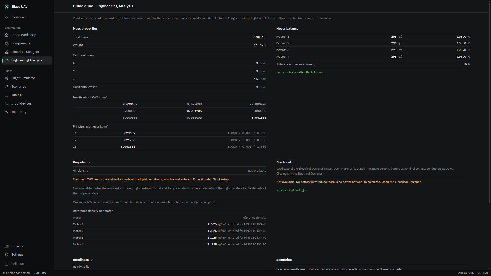

# Engineering Analysis

Open **Engineering Analysis** from the sidebar and choose your project. Use the page to review the build before you start a run. [Project chooser](../../src/features/analysis/AnalysisPage.tsx#L30)

1. In **Mass properties**, check total mass, centre of mass, and the inertia tensor. Body X is forward, Y is left, and Z is up. Review any missing masses.
2. In **Hover balance**, compare each motor's thrust share with the mean and the tolerance set in the workshop's **Mass** panel.
3. In **Propulsion**, check **Maximum T/W**, full-throttle pack voltage and current, and the individual motor results. The estimate uses the full-throttle pack sag and the flight air density.
4. Read **Electrical** and **Readiness**. Use linked findings to open the field that needs attention. A value marked **not available** can reflect missing data. Use **Scenarios** to run a test on this build, then **Telemetry** to open a saved recording. [Mass and inertia](../../src/features/analysis/AnalysisPage.tsx#L177) · [Hover balance](../../src/features/analysis/AnalysisPage.tsx#L250) · [Propulsion](../../src/features/analysis/AnalysisPage.tsx#L285) · [Electrical and readiness](../../src/features/analysis/AnalysisPage.tsx#L363) · [Scenarios link](../../src/features/analysis/AnalysisPage.tsx#L159)
