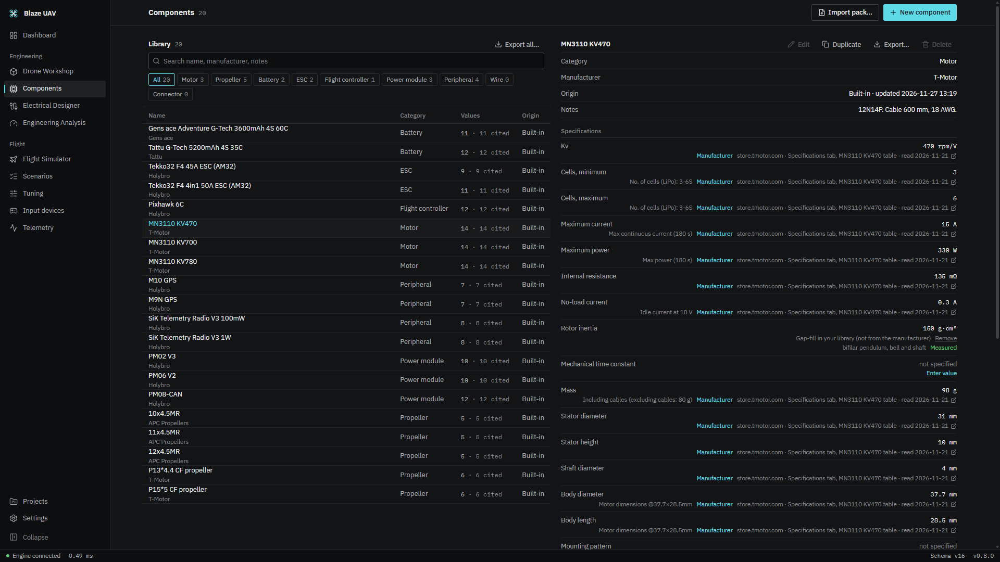
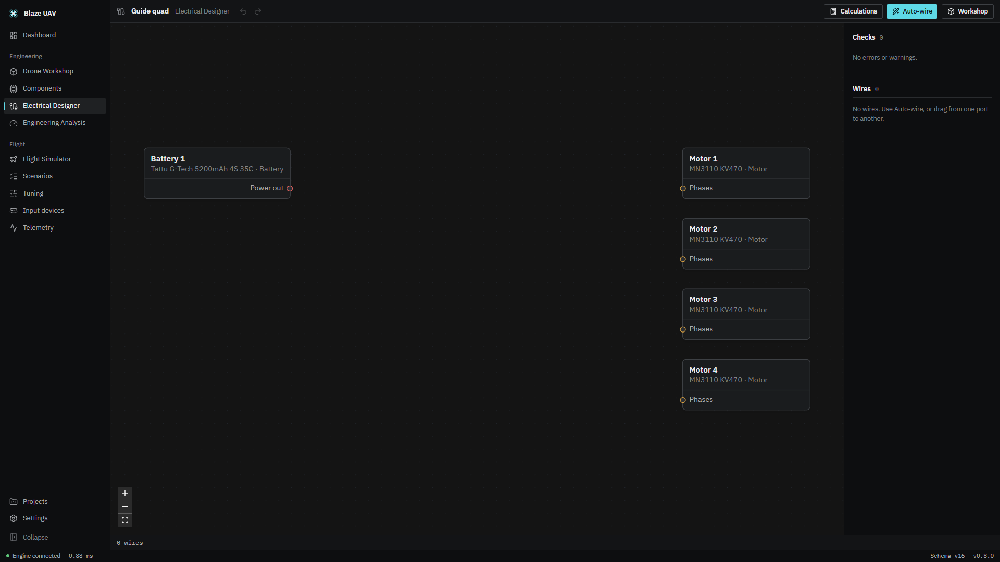

# Components and electrical checks

## Component data

1. Open **Components**. Select an item in **Library** and read its specifications and their sources. Use **New component** for a part you have data for, or **Import pack…** for a component pack. Use **Duplicate** to make an editable copy of a built-in item.
2. For a missing library value, choose **Enter value**. Record the value, its source, and the condition it applies to. For a value that applies to just one part, use **Override** on that part in Drone Workshop. Review the linked component on each part. [Component actions](../../src/features/components/ComponentsPage.tsx#L74) · [Duplicate](../../src/features/components/ComponentsPage.tsx#L282) · [Missing values](../../src/features/components/ComponentsPage.tsx#L374) · [Part override](../../src/features/workshop/PartPanels.tsx#L875)

## Electrical Designer

1. Open **Electrical Designer** and choose the project. Add the electrical parts in Drone Workshop so their ports appear on the schematic.
2. Drag from one port to another on the schematic or choose **Auto-wire** to build the reference harness. When replacing existing wires, review the confirmation and read **Auto-wire notes**.
3. Select a wire. Check its endpoints and enter its **Gauge (AWG)** and **Length (mm)**. Review **Checks** for problems. Open **Calculations** for current, voltage drop and losses where the required inputs are present. [Project chooser and wiring controls](../../src/features/electrical/ElectricalPage.tsx#L67) · [Schematic and auto-wire](../../src/features/electrical/ElectricalPage.tsx#L164) · [Wire fields](../../src/features/electrical/ElectricalPage.tsx#L461) · [Checks](../../src/features/electrical/ElectricalPage.tsx#L604) · [Calculations](../../src/features/electrical/CalculationsPanel.tsx)

Next, [review Engineering Analysis](analysis.md).
