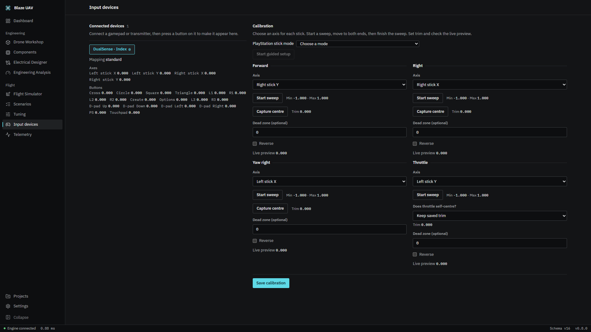
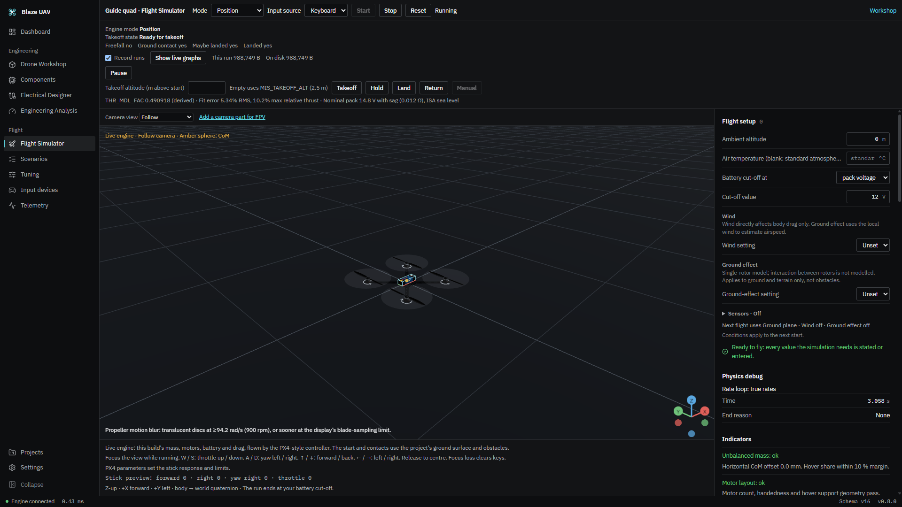

# First flight

## Set the flight conditions

1. Open **Flight Simulator** and choose your project. In **Flight setup**, enter **Ambient altitude**. Enter **Air temperature** if you have a value for this run. A blank temperature uses the standard atmosphere.
2. Under **Battery cut-off at**, choose **pack voltage** or **charge drawn**. Enter the corresponding **Cut-off value** in V or mAh. The run ends at that limit.
3. Follow the missing-input links. In Drone Workshop, use **Environment** to enter friction and restitution for the ground or terrain and each obstacle you use. Configure wind or ground effect in **Flight setup** if they are part of this run. Wait for **Ready to fly** and an engine connection before starting. Conditions take effect at the next start. [Flight setup](../../src/features/flight/FlightSetup.tsx#L63) · [Surface inputs](../../src/features/workshop/EnvironmentPanel.tsx#L48) · [Start and cutoff](../../src/features/flight/FlightPage.tsx#L431)

## Calibrate a gamepad

1. Connect a gamepad and open **Input devices**. Press a button to make it appear under **Connected devices**, then select it. Move the sticks and confirm the **Axes** readings respond.
2. For each control, pick an **Axis**. Choose **Start sweep**, move to both ends, then choose **Finish sweep**. Use **Capture centre** with the stick released. For throttle that does not centre, choose **No, use measured midpoint**. If available, **Use standard gamepad preset** assigns the axes.
3. For a recognized PlayStation gamepad, you can choose a **PlayStation stick mode** and **Start guided setup**. Sweep both sticks, then release them for the rest measurement. Use **Use measured spread as dead zone** if you want to apply that measurement.
4. Check the live preview and use **Reverse** if an axis moves in the wrong direction. Choose **Save calibration**. In **Flight Simulator**, select the device in **Input source** before starting and use a PX4 mode. If the run pauses after a disconnect, reconnect and follow the status shown beside the pause control. [Connected devices](../../src/features/input/InputPage.tsx#L17) · [Calibration](../../src/features/input/CalibrationPanel.tsx#L93) · [Guided setup](../../src/features/input/PlayStationSetup.tsx#L57) · [Input and pause controls](../../src/features/flight/FlightControls.tsx#L22)

## Start, take off and land

- **Stabilized** uses stick tilt and yaw with direct throttle shaping. **Altitude** adds altitude hold when the vertical stick is centred and the craft slows enough. **Position** adds horizontal braking and position hold. **Attitude hold** uses the keyboard and targets zero vertical speed at centred throttle. [Mode labels](../../src/features/flight/flight-mode.ts#L6) · [Manual mode behaviour](../plans/phase-5-flight-control.md#L166) · [Attitude hold](../../src/features/flight/FlightPage.tsx#L497)

1. Select **Position**, choose an **Input source**, and click **Start**. For keyboard input, focus the flight view. Use **W/S** for throttle, **A/D** for yaw, and the arrow keys for pitch and roll. Release the keys to centre them.
2. Enter **Takeoff altitude (m above start)** and click **Takeoff**. A blank field uses the app's displayed takeoff setting. Use **Hold** to capture a position and heading. Use **Manual** to go back to the selected mode.
3. Click **Land** to descend in place. To fly back to the run start and land there, use **Return**. Return uses a straight path and has no obstacle avoidance. Check the ground and the path first.
4. Use **Stop** to end the run. **Reset** returns the view and readouts to the starting state. Enable **Record runs** before starting if you want a saved recording. [Flight controls](../../src/features/flight/FlightPage.tsx#L414) · [Keyboard inputs](../../src/features/flight/FlightPage.tsx#L479) · [Automatic commands](../../src/features/flight/FlightControls.tsx#L70) · [Hold and land](../../simulation-engine/engine-core/src/auto_modes.rs#L55) · [Return limits](../validation/report.md#L603)

Next, [run scenarios](scenarios.md) or [review your recording](telemetry.md).
