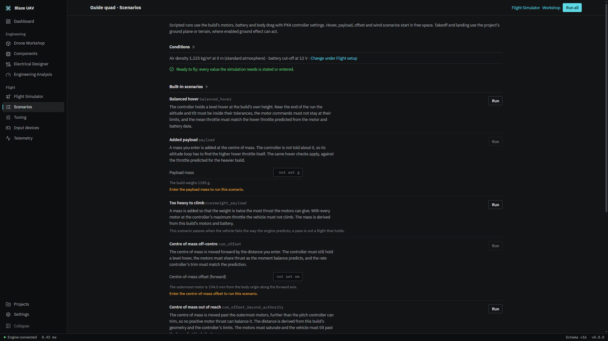

# Scenarios

1. Open **Scenarios** and select your project. Review **Conditions** and follow the links to fill in missing build or flight inputs.
2. Start with **Balanced hover**. Enter the requested input for any scenario that needs one. For example, **Added payload** needs **Payload mass** and **Wind hold** needs **Mean wind**. **Gust recovery** needs **Gust**. The ground and terrain cases use the project's surface settings.
3. Choose **Run** on a row, or **Run all** to run the cases that are ready.
4. Read the verdict, the changes applied for the test, and each check. In **Too heavy to climb** and **Centre of mass out of reach**, an expected failure of the vehicle can be a passing test. The page shows results for this session. Enable **Record runs** in Settings before running if you want to open the saved runs in Telemetry. [Run controls and conditions](../../src/features/scenarios/ScenariosPage.tsx#L161) · [Built-in cases](../../src/features/scenarios/scenarios.ts#L32) · [Checks and verdict](../../src/features/scenarios/ScenariosPage.tsx#L286) · [Results storage](../../src/features/analysis/AnalysisPage.tsx#L159) · [Recording default](../../src/features/settings/SettingsSections.tsx#L196)

