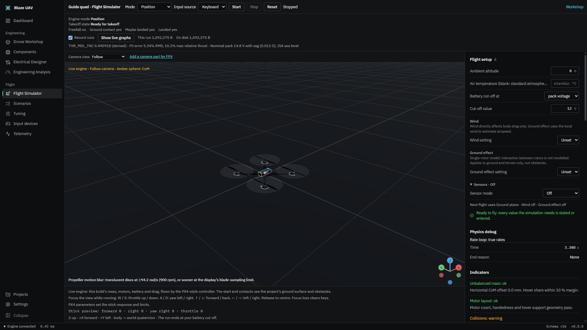

# Sensors

1. Open your project in **Flight Simulator**. Expand **Sensors** under **Flight setup**.
2. Choose the **Sensor mode**. **Off** disables the models. **Recorded only** adds modelled samples while control uses simulated truth. **Fly on gyro** feeds the filtered modelled gyro to the rate loop. The attitude, position and velocity loops still use simulated truth.
3. Choose the installed flight controller or GPS part if there are several candidates. If there are no parts to use as sources, enter values manually. A blank override uses a catalogue value when available. Enter `off` where offered to disable an effect. Enter or choose a **Seed (repeats sensor noise)** to repeat the same noise sequence under the same conditions.
4. Enter the measured values for the effects you want, including extra vibration noise if you have a log. Enable **Record runs** before starting. In [Telemetry](telemetry.md), pick the available sensor channels under **Graphs**. [Flight setup](../../src/features/flight/FlightSetup.tsx#L92) · [Modes and inputs](../../src/features/flight/sensors/SensorSection.tsx#L187) · [Sensor model and filter boundary](../adr/0011-telemetry-recording-and-sensor-models.md#L13) · [Recording controls](../../src/features/flight/FlightPage.tsx#L446)

Simulated gyro, accelerometer, barometer and GPS channels cover selected effects such as noise, bias and delay. Motor vibration can be represented by extra white noise from a log. See [model limits](model-limits.md). [Sensor notice](../../src/features/flight/sensors/SensorSection.tsx#L27)
