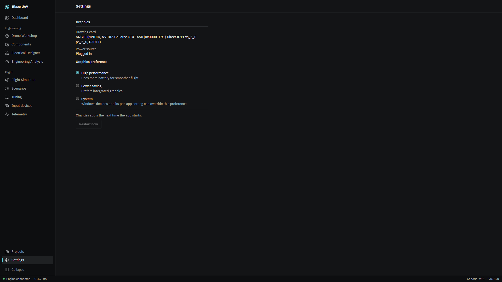

# Settings, backups and diagnostics

Open **Settings** from the sidebar. [Settings sections](../../src/features/settings/SettingsPage.tsx#L117)

## Graphics

Under **Graphics**, check **Drawing card** and **Power source**. **High performance** is the app default. **Power saving** prefers integrated graphics. **System** lets Windows decide. Choose a preference and click **Restart now** to apply it. Windows can override the preference for the app. Check **Drawing card** again after restart. [Graphics options](../../src/features/settings/GraphicsSection.tsx#L5) · [Restart control](../../src/features/settings/GraphicsSection.tsx#L55) · [Default decision](../plans/phase-8-quality.md#L60)

## Data and restore

- Under **Data**, choose **Open data folder**. For a full backup, close Blaze UAV and copy the whole folder to another location. It contains the database and related files such as models, terrain and recordings. [Data overview](../../src/features/settings/SettingsSections.tsx#L63) · [Full-folder backup](../release/README.md#L30)
- Under **Database copies**, the app keeps the last three copies made before migrations. To use one, finish any recording, choose **Restore** beside the date and schema you need, then confirm with **Restore database**. The app restarts. A copy restores database rows such as projects and recording entries. Models, terrain and recording files live alongside the database and need their own copies. [Retention](../../electron/main/db/safety.ts#L12) · [Restore dialog and scope](../../src/features/settings/SettingsSections.tsx#L87) · [Recording guard](../../electron/main/index.ts#L565)
- To move one project, open **Projects** and choose **Export project** on its row. The `.blazeproj` file includes its models and terrain. Select **Include recordings** to take those too. On the other PC, open **Projects → Import project** and pick that file. [Project export](../../src/features/projects/ProjectsPage.tsx#L178) · [Project import](../../src/features/projects/ProjectsPage.tsx#L48)

## Logs and diagnostics

Under **Logs and diagnostics**, click **Open log folder** to see the local logs. Choose **Preview diagnostics** to see what a diagnostic zip will contain. Leave **Include database** clear unless you want to include its data. Click **Save diagnostics** and choose the destination. The app saves the file locally for you to share. [Diagnostics controls](../../src/features/settings/SettingsSections.tsx#L147) · [Local logging decision](../plans/phase-8-quality.md#L58)

## Self-check and versions

Press **Alt** if the menu is hidden, then choose **Help → Check this computer**. The dialog runs three saved inputs and compares each final state hash with its expected value. Read the CPU name and each result. The check applies to those inputs on that computer. Under **Settings → About**, find the app, engine and protocol versions and the third-party notices. [Self-check](../release/README.md#L38) · [Hidden menu](../../electron/main/index.ts#L157) · [About](../../src/features/settings/SettingsSections.tsx#L214)
