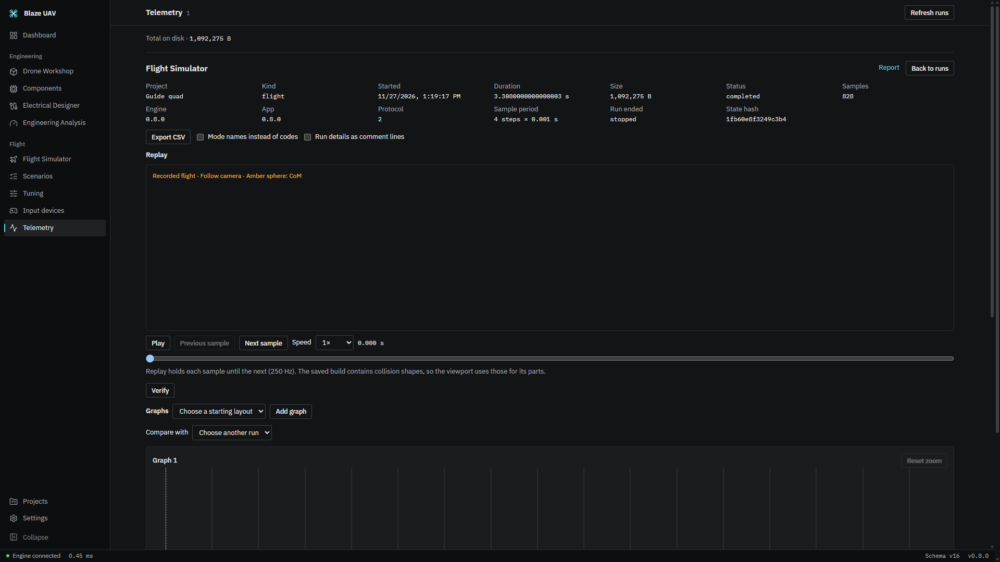
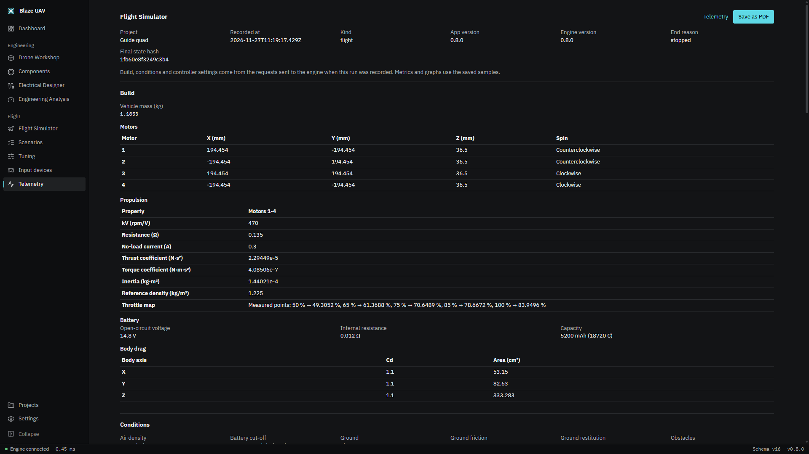

# Telemetry, replay and reports

## Record and replay

1. In **Flight Simulator**, enable **Record runs** before **Start**. Click **Show live graphs** to see channels during flight. **Settings → Recording → Record runs** controls the default for flights, scenarios, and step tests.
2. End the run. Open **Telemetry** and select the run by its title. Use **Refresh runs** if needed.
3. In **Replay**, use **Play**, drag the position slider, or use **Previous sample** and **Next sample**. Playback uses saved poses when present. An incomplete or damaged file can end at the last intact sample. [Flight recording controls](../../src/features/flight/FlightPage.tsx#L444) · [Recording default](../../src/features/settings/SettingsSections.tsx#L196) · [Run list](../../src/features/telemetry/TelemetryPage.tsx#L212) · [Replay controls](../../src/features/telemetry/ReplayPanel.tsx#L82)

## Verify and compare

- Choose **Verify** to rerun the recorded inputs in a separate engine and check the final state hash. Verification requires a complete recording with the matching engine and protocol versions. Playback uses saved samples, so it can still work when an older run **cannot verify**. [Verify button](../../src/features/telemetry/VerifyPanel.tsx#L50) · [Requirements](../adr/0011-telemetry-recording-and-sensor-models.md#L12) · [Upgrade behaviour](../release/README.md#L36)
- Under **Graphs**, choose a **Starting layout** or use **Add graph** and choose channels. Pick a second recording under **Compare with**. Use **Align by → Run start** to compare elapsed times, or **Selected moments** to match one moment from each run. The page lists channels missing from either run. [Graph and comparison controls](../../src/features/telemetry/RunGraphs.tsx#L194)

## Save a CSV or PDF

- Click **Export CSV** and choose a destination. **Mode names instead of codes** changes how modes are written. **Run details as comment lines** adds metadata at the top of the file. [CSV controls](../../src/features/telemetry/TelemetryPage.tsx#L67)
- Open **Report** from the selected run. Review the recorded build, conditions, controller settings, graphs, metrics and model limits. Click **Save as PDF** and choose a destination. The report uses the settings sent when the run was recorded. [Report link](../../src/features/telemetry/TelemetryPage.tsx#L130) · [Report content](../../src/features/telemetry/report/ReportPage.tsx#L63) · [PDF control](../../src/features/telemetry/report/ReportPage.tsx#L143)

