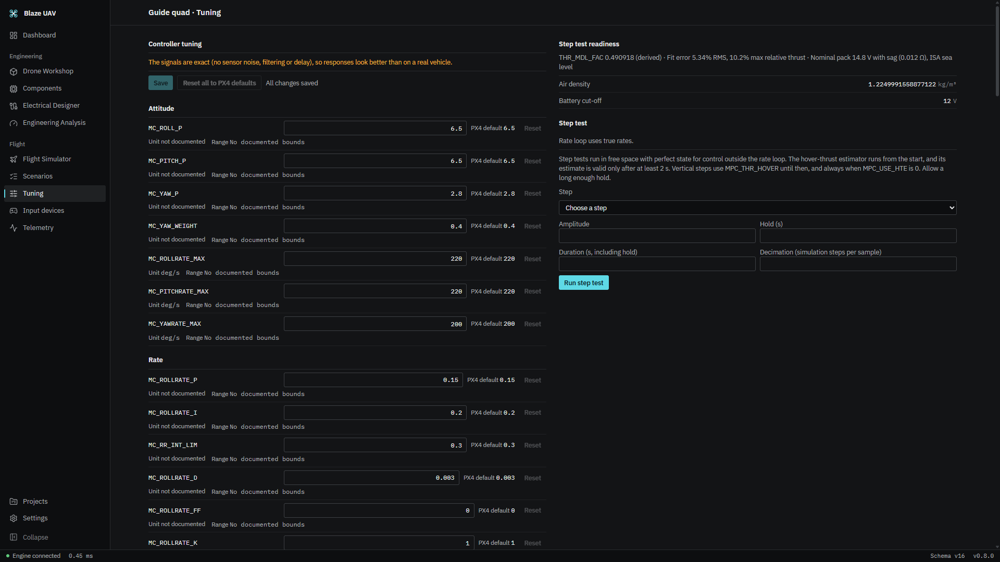

# Tuning and step tests

1. Open **Tuning** and choose your project. Resolve the missing inputs under **Step test readiness**.
2. Find the parameter you want to change. Check the **PX4 default**, unit, and documented range beside it. Choose **Save** to apply the edited values. Use a row's **Reset** to clear that override in the draft, or **Reset all to PX4 defaults** to clear the saved overrides. Some overrides only apply in the PX4 flight modes. [Tuning page](../../src/features/tuning/TuningPage.tsx#L76) · [Parameter controls](../../src/features/tuning/TuningPanel.tsx#L94) · [Flight mode warning](../../src/features/flight/FlightPage.tsx#L475)

3. Under **Step test**, pick a rate, attitude, altitude, or position step. Enter **Amplitude**, **Hold (s)**, **Duration (s, including hold)** and **Decimation (simulation steps per sample)**. Hold is the time before the command changes. Duration includes the hold and response. Choose **Run step test**. It uses the last saved gains.
4. Compare the command and measured response. Review rise time, overshoot, settling time, and steady-state error. The test runs in free space and the metrics use the true motion. For vertical steps, the hover-thrust estimator needs at least 2 s to become valid. The app uses `MPC_THR_HOVER` until then or throughout if the estimator is disabled. [Step choices](../../src/features/tuning/step-test-input.ts#L13) · [Inputs and estimator note](../../src/features/tuning/StepTestPanel.tsx#L14) · [Run and result](../../src/features/tuning/StepTestPanel.tsx#L97) · [Response metrics](../../src/features/tuning/StepResponsePanel.tsx#L138)
