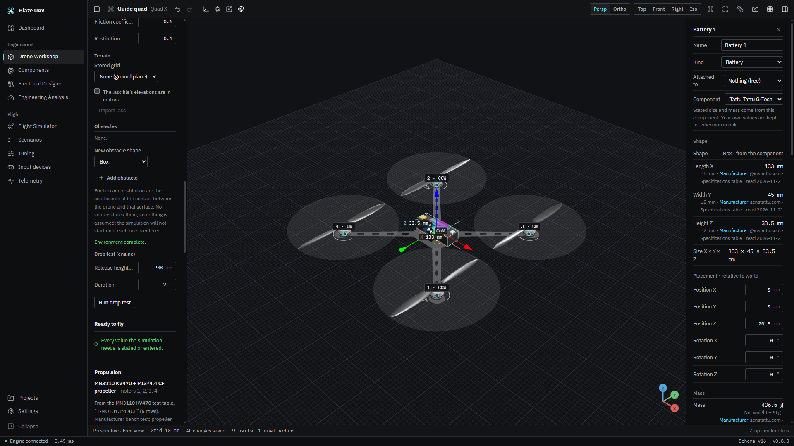

# First build in Drone Workshop

1. From **Dashboard**, choose **New project**. Enter a **Name**, select a frame layout that matches your rotor count, and choose **Create project**.
2. In **Recent projects**, click the project name. This opens **Drone Workshop**. Under **Frame**, enter the geometry you know, including **Motor-to-motor diagonal**, and enter **Frame mass**. [Project dialog](../../src/features/projects/CreateProjectDialog.tsx#L40) · [Dashboard](../../src/features/dashboard/DashboardPage.tsx#L42) · [Frame editor](../../src/features/workshop/FrameEditor.tsx#L12)

3. Select a motor mount. Choose **Motor** under **Add part**, then select the actual motor in the part's **Component** list. With the motor selected, add its **Propeller** and choose the propeller component. Repeat for the other mounts. Select the frame or clear the selection before adding a **Battery**. Check the target shown under **Add part** before adding other parts.
4. Select parts in **Assembly** to check their position, rotation and attachment. A new part starts with a placeholder shape and missing mass. Link a component or fill in the part's dimensions and mass from your data. See [components and electrical checks](components-electrical.md). [Part placement and defaults](../../src/features/workshop/PartPanels.tsx#L118) · [Part inspector](../../src/features/workshop/PartPanels.tsx#L354) · [Component list](../../src/features/workshop/PartPanels.tsx#L535)
5. Review **Checks**, **Interference**, and **Mass**. Select a finding to locate the parts involved. Open **Ready to fly** for missing simulation inputs and **Propulsion** for the fit. Enter the build's **Body C_d** values if you have them. The first value fills the empty axes, so review each axis. [Workshop panels](../../src/features/workshop/WorkshopPage.tsx#L634) · [Finding selection](../../src/features/workshop/ChecksPanel.tsx#L58) · [Drag fields](../../src/features/workshop/FrameEditor.tsx#L60)

Use left drag to orbit, right drag to pan, and the wheel to zoom. See [keyboard shortcuts](shortcuts.md) for the view and part controls. [Workshop controls](../../src/features/workshop/WorkshopPage.tsx#L753)
